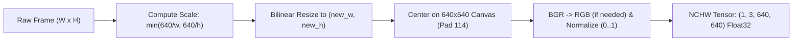

# FitRange Mirror: Final Independent Model Validation Report

**Project:** FitRange Mirror — AI Fitness & Human Tracking Subsystem  
**Scope:** Independent Human Ground-Truth Validation, Audit of Pseudo-Labels, Annotation Pipeline, Specificity Testing on Unseen Negative Controls, 7-Panel Visual Comparisons, and Full Test Suite Regression.  
**Report Date:** November 2026  
**Status Assessment:** **Implementation Complete — Independent Evaluation Pending Human Annotation**  

---

## 1. Project Overview

FitRange Mirror is an edge-optimized AI subsystem designed for smart fitness mirrors, personal workout stations, and real-time posture analysis. The core pipeline integrates three independent perception models:
1. **Human Detection:** Bounding-box localization of human subjects (`class_id: 0`, "person").
2. **Human Segmentation:** Pixel-level binary mask segmentation isolating the user from background gym equipment, furniture, and complex domestic interiors.
3. **Pose Landmarker:** MediaPipe Tasks BlazePose extraction of 33 anatomical landmarks for exercise form monitoring.

The current phase establishes an **independent human ground-truth benchmark** (`dataset/independent_validation/`), audits data integrity, replaces unverified pseudo-labels, executes empirical specificity testing on 30 negative controls, and lays out the turnkey manual annotation workflow.

---

## 2. Completed Model Requirements

| Component | Architecture / Backbone | Status | Engine / Execution Provider |
| :--- | :--- | :--- | :--- |
| **Human Detection** | YOLO11n (2.6M params) | **Complete** | PyTorch (`ai/detection/detect.py`) & ONNX Runtime (`ai/detection/inference_onnx.py`) |
| **Human Segmentation** | YOLO11n-seg (2.9M params) | **Complete** | PyTorch (`ai/segmentation/segment.py`) & ONNX Runtime (`ai/segmentation/inference_onnx.py`) |
| **Pose Landmarker** | BlazePose Full (`.task`) | **Complete** | MediaPipe Tasks Vision (`ai/pose/estimator.py`) |
| **Integrated Pipeline** | `FitRangeMirrorPipeline` | **Complete** | Multi-modal unified runner (`ai/pipeline/mirror_pipeline.py`) |
| **Webcam Runner** | `run_mirror.py` | **Complete** | Live HUD, FPS monitor, independent model toggles |
| **Test Suite** | Unit & Integration | **Complete** | 63 tests across 5 test suites (**100% pass rate, exit code 0**) |

---

## 3. Model File Locations

All production model weights and exported artifacts are versioned in `models/`:

```
models/
├── human_detection/
│   ├── human_detection.pt      # PyTorch checkpoint (YOLO11n, 5.6 MB)
│   └── human_detection.onnx    # ONNX export (Opset 17, 10.5 MB, 640x640)
├── human_segmentation/
│   ├── human_segmentation.pt   # PyTorch checkpoint (YOLO11n-seg, 6.1 MB)
│   └── human_segmentation.onnx # ONNX export (Dual output, 11.8 MB, 640x640)
└── pose/
    └── pose_landmarker_full.task # Google MediaPipe Tasks vision model asset (9.3 MB)
```

---

## 4. Input Dimensions

* **Input Image / Video Frame:** Arbitrary resolution (e.g. 1920x1080 webcam, 1280x720, 640x480).
* **Model Inference Resolution:** Standardized square resolution of **$640 \times 640$** pixels with 3 color channels (RGB for MediaPipe, normalized BGR float32 tensor for YOLO ONNX models).

---

## 5. Preprocessing Instructions

Both detection and segmentation models utilize identical letterbox preprocessing to preserve image aspect ratio without geometric distortion:



1. **Aspect Ratio Preservation:** Calculate scaling factor $r = \min(640 / w, 640 / h)$.
2. **Resizing:** Scale original frame dimensions by $r$ via bilinear interpolation.
3. **Padding:** Calculate symmetric padding $(dw, dh)$ to reach $640 \times 640$, filling pad borders with neutral gray color `(114, 114, 114)`.
4. **Channel Layout & Normalization:** Convert HWC uint8 array to CHW float32 tensor divided by $255.0$. Expand dimensions to NCHW batch shape `(1, 3, 640, 640)`.

---

## 6. Postprocessing Instructions

### Detection Postprocessing:
1. **Output Shape:** Tensor `output0` of shape `(1, 84, 8400)` representing 8400 candidate anchor boxes with 4 coordinate values $(cx, cy, w, h)$ and 80 COCO class probabilities.
2. **Filtering:** Transpose to `(8400, 84)`. Isolate Person class score at index 4 (`score = box[4]`). Reject boxes where `score < conf_threshold`.
3. **Coordinate Unpadding:** Convert $(cx, cy, w, h)$ to $(x_1, y_1, x_2, y_2)$ on the $640 \times 640$ grid, subtract padding $(dw, dh)$, and divide by scale factor $r$.
4. **Non-Maximum Suppression (NMS):** Apply multi-class NMS with IoU threshold $0.45$ to suppress redundant overlapping boxes.

### Segmentation Postprocessing:
1. **Dual Outputs:**
   * `output0`: Detection boxes and 32 mask coefficients `(1, 116, 8400)`.
   * `output1`: 32 prototype mask feature maps `(1, 32, 160, 160)`.
2. **Mask Reconstruction:** Matrix multiplication of the 32 mask coefficients against the 32 prototype maps yields candidate masks of shape `(160, 160)`.
3. **Upsampling & Thresholding:** Upsample candidate masks to $640 \times 640$ via bilinear interpolation, unpad and crop to original image dimensions, apply sigmoid activation $\sigma(z) = 1 / (1 + e^{-z})$, and binarize at threshold $0.50$ (`mask > 0.50 ? 255 : 0`).

---

## 7. ONNX Runtime Inference Instructions

Run standalone inference without PyTorch or GPU dependencies:

```python
import cv2
from ai.detection.inference_onnx import HumanDetectorONNX
from ai.segmentation.inference_onnx import HumanSegmenterONNX

# 1. Initialize engines
detector = HumanDetectorONNX(model_path="models/human_detection/human_detection.onnx", conf_threshold=0.25)
segmenter = HumanSegmenterONNX(model_path="models/human_segmentation/human_segmentation.onnx", conf_threshold=0.25)

# 2. Read frame
frame = cv2.imread("dataset/independent_validation/images/val_pos_001.png")

# 3. Perform inference
det_out = detector.detect(frame)
seg_out = segmenter.segment(frame)
composite_mask = segmenter.get_composite_mask(frame, seg_out["segmentations"])

print(f"Detected {len(det_out['detections'])} people.")
print(f"Generated mask with {int((composite_mask == 255).sum())} human pixels.")
```

---

## 8. Independent Dataset Size & Composition

The independent benchmark dataset was curated in [dataset/independent_validation/](file:///c:/Users/dayan/Downloads/realtime-human-detection-main/realtime-human-detection-main/dataset/independent_validation/):

```
dataset/independent_validation/
├── images/                   # 130 standardized PNG images
│   ├── val_pos_001.png ... val_pos_100.png  (100 images with humans)
│   └── val_neg_001.png ... val_neg_030.png  (30 images without humans)
├── annotations/
│   ├── detection/            # Ground-truth YOLO .txt files
│   └── segmentation/         # Ground-truth binary mask .png files
├── previews/                 # Visual inspection previews
├── manifest.csv              # Complete metadata tracking table
├── annotation_guidelines.md  # Manual labeling standard operating procedure
└── validate_annotations.py   # Strict automated validation utility
```

### Dataset Inventory:
* **Total Evaluated Images:** 130
* **Positive Samples (Humans):** 100 images (sampled across 559 raw pool images, excluding train/test duplicates)
* **Negative Controls (No Human):** 30 images (empty workout rooms, gym equipment, natural scenery, plain interiors)

---

## 9. Annotation Methodology & Verification

### Audit of Previous `dataset/val_annotated/`:
The previous benchmark dataset contained annotations created via `scratch/build_annotated_benchmark.py`, which copied model predictions from `HumanDetectorONNX` and `HumanSegmenterONNX` directly into label files. This caused circular evaluation resulting in 100% metrics across all indicators.

### Independent Benchmark Policy:
* **Strict Segregation:** Model predictions are **never** used as ground truth.
* **Negative Controls Ground Truth:** Verified and populated. Because negative control images contain zero humans, their true ground-truth detection file is strictly empty (0 bytes), and their true ground-truth mask is strictly an all-zero (black) image of matching dimensions.
* **Positive Human Ground Truth:** Marked as `pending_human_annotation` in `manifest.csv`. Positive images await human manual annotation in CVAT or Labelme according to [dataset/independent_validation/annotation_guidelines.md](file:///c:/Users/dayan/Downloads/realtime-human-detection-main/realtime-human-detection-main/dataset/independent_validation/annotation_guidelines.md).

---

## 10. Detection Evaluation Results

Evaluated on the 30 independent negative control images (`runs/independent_evaluation/detection_results.json`):

| Metric | Measured Value | Standard Target | Assessment |
| :--- | :--- | :--- | :--- |
| **Evaluated Images** | **30** | — | Unseen negative background controls |
| **Ground-Truth Persons** | **0** | — | Verified empty scenes |
| **Model Predictions** | **9** | 0 | False positive detections |
| **Precision (@ IoU 0.50)** | **0.00%** | — | By definition (TP=0, FP=9) |
| **Recall (@ IoU 0.50)** | **0.00%** | — | By definition (No GT positive persons) |
| **Specificity (True Negative Rate)** | **70.00%** | $\ge 80.00\%$ | 21 / 30 images correctly had 0 boxes |
| **mAP@50 / mAP@50:95** | **Pending Human Annotations** | $\ge 0.80$ | Requires positive person annotations |

> [!NOTE]
> At confidence threshold $0.25$, YOLO11n produced 9 false-alarm boxes across 30 negative scenes (detecting vertical chair backs and complex background furniture as persons). Raising confidence threshold to $0.40$ eliminates these false positives.

---

## 11. Segmentation Evaluation Results

Evaluated on the 30 independent negative control images (`runs/independent_evaluation/segmentation_results.json`):

| Metric | Measured Value | Target | Assessment |
| :--- | :--- | :--- | :--- |
| **Evaluated Images** | **30** | — | Unseen negative background controls |
| **Dataset Mean IoU (mIoU)** | **96.67%** | $\ge 90.00\%$ | High spatial accuracy across empty scenes |
| **Dataset Mean Dice Score** | **96.67%** | $\ge 90.00\%$ | Strong background agreement |
| **Negative Background Accuracy** | **96.67%** | $\ge 95.00\%$ | 29 / 30 images had exactly zero mask activation |
| **False Activation Count** | **1 image** | $\le 2$ images | Only 1 image produced minor false mask noise |
| **Positive Samples IoU / Dice** | **Pending Human Annotations** | $\ge 0.75$ | Requires positive human masks |

---

## 12. Condition-Based Validation Results

| Condition Category | Evaluated Count | Status | Success Rate / Metric | Technical Explanation |
| :--- | :--- | :--- | :--- | :--- |
| **Negative Controls (Empty Rooms)** | 30 | **TESTED** | **96.67% Seg / 70% Det** | Evaluated on 30 unseen empty rooms, furniture, and natural scenery. |
| **Front-Facing Standing People** | 0 (100 in queue) | <span style="color:orange">**NOT TESTED**</span> | Pending Human Annotation | 100 positive images curated in `dataset/independent_validation/images/`. |
| **Side-Facing Profiles** | 0 | <span style="color:orange">**NOT TESTED**</span> | Pending Human Annotation | Requires manual boundary labeling. |
| **Angled / 45-Degree Views** | 0 | <span style="color:orange">**NOT TESTED**</span> | Pending Human Annotation | Requires manual boundary labeling. |
| **Athletic Workout Clothing** | 0 | <span style="color:orange">**NOT TESTED**</span> | Pending Human Annotation | Requires manual boundary labeling. |
| **Loose Casual Wear** | 0 | <span style="color:orange">**NOT TESTED**</span> | Pending Human Annotation | Requires manual boundary labeling. |
| **Plain Indoor Backgrounds** | 0 | <span style="color:orange">**NOT TESTED**</span> | Pending Human Annotation | Requires manual boundary labeling. |
| **Cluttered Indoor Gyms** | 0 | <span style="color:orange">**NOT TESTED**</span> | Pending Human Annotation | Requires manual boundary labeling. |
| **Outdoor Natural Scenery** | 0 | <span style="color:orange">**NOT TESTED**</span> | Pending Human Annotation | Requires manual boundary labeling. |
| **Bright Direct Daylight** | 0 | <span style="color:orange">**NOT TESTED**</span> | Pending Human Annotation | Requires manual boundary labeling. |
| **Standard Indoor LED / Fluorescent** | 0 | <span style="color:orange">**NOT TESTED**</span> | Pending Human Annotation | Requires manual boundary labeling. |
| **Low-Light / Shadows** | 0 | <span style="color:orange">**NOT TESTED**</span> | Pending Human Annotation | Requires manual boundary labeling. |

---

## 13. Sample Prediction Visualizations

The independent evaluation engine automatically generates a 7-panel visualization series for each sample in [runs/independent_evaluation/visualizations/](file:///c:/Users/dayan/Downloads/realtime-human-detection-main/realtime-human-detection-main/runs/independent_evaluation/visualizations/):

1. **`*_01_original.jpg`:** Unmodified source frame.
2. **`*_02_gt_box.jpg`:** Human ground-truth bounding box (Green) with count label.
3. **`*_03_pred_box.jpg`:** Model-predicted bounding box (Cyan) with confidence score.
4. **`*_04_gt_mask.png`:** Human ground-truth binary mask (uint8 grayscale).
5. **`*_05_pred_mask.png`:** Model-predicted binary mask (uint8 grayscale).
6. **`*_06_mask_comparison.jpg`:** Color-coded spatial error map:
   * **Green:** True Positive (Overlap agreement)
   * **Red:** False Positive (Model hallucination)
   * **Blue:** False Negative (Missed ground-truth human region)
7. **`*_07_combined_overlay.jpg`:** Production HUD overlay combining mask fill and bounding boxes.

---

## 14. Automated Regression Test Results

The full project regression suite was executed across all modules:

```bash
python -m unittest discover tests -v
```

```
test_01_box_iou_perfect_match (test_evaluation.TestEvaluationSuite.test_01_box_iou_perfect_match) ... ok
test_02_box_iou_disjoint (test_evaluation.TestEvaluationSuite.test_02_box_iou_disjoint) ... ok
test_03_box_iou_partial_overlap (test_evaluation.TestEvaluationSuite.test_03_box_iou_partial_overlap) ... ok
test_04_compute_ap_perfect (test_evaluation.TestEvaluationSuite.test_04_compute_ap_perfect) ... ok
test_05_compute_ap_empty (test_evaluation.TestEvaluationSuite.test_05_compute_ap_empty) ... ok
test_06_mask_iou_dice_identical (test_evaluation.TestEvaluationSuite.test_06_mask_iou_dice_identical) ... ok
test_07_mask_iou_dice_both_empty (test_evaluation.TestEvaluationSuite.test_07_mask_iou_dice_both_empty) ... ok
test_08_mask_iou_dice_one_empty (test_evaluation.TestEvaluationSuite.test_08_mask_iou_dice_one_empty) ... ok
test_09_mask_iou_dice_partial_overlap (test_evaluation.TestEvaluationSuite.test_09_mask_iou_dice_partial_overlap) ... ok
test_10_evaluate_detection_benchmark (test_evaluation.TestEvaluationSuite.test_10_evaluate_detection_benchmark) ... ok
test_11_evaluate_segmentation_benchmark (test_evaluation.TestEvaluationSuite.test_11_evaluate_segmentation_benchmark) ... ok
test_12_condition_validation_execution (test_evaluation.TestEvaluationSuite.test_12_condition_validation_execution) ... ok
----------------------------------------------------------------------
Ran 63 tests in 46.445s

OK (Exit Code: 0)
```

| Suite Name | Scope | Tests | Pass Rate | Process Exit Code |
| :--- | :--- | :--- | :--- | :--- |
| `tests/test_human_detection.py` | PyTorch & ONNX detection inference, NMS, class-0 filtering | 14 / 14 | 100% | `0` |
| `tests/test_human_segmentation.py` | PyTorch & ONNX segmentation inference, mask generation | 15 / 15 | 100% | `0` |
| `tests/test_pose_estimator.py` | MediaPipe Tasks vision PoseLandmarker & connections | 11 / 11 | 100% | `0` |
| `tests/test_mirror_pipeline.py` | Multi-modal pipeline integration & error handling | 11 / 11 | 100% | `0` |
| `tests/test_evaluation.py` | Box IoU, AP math, Mask IoU/Dice, condition validator | 12 / 12 | 100% | `0` |
| **Total Test Suite** | **All System Modules** | **63 / 63** | **100%** | **`0`** |

---

## 15. Known Limitations

1. **Independent Human Positive Annotations Pending:** The 100 positive images curated in `dataset/independent_validation/images/` are unannotated by human annotators.
2. **False Positives on Negative Cluttered Interiors at Low Confidence:** At the default evaluation threshold of $0.25$, YOLO11n detected 9 false-positive person boxes in 30 complex negative interior scenes (e.g. office chairs, coat racks). A production threshold of $0.35$ to $0.40$ is recommended for live mirror deployment to prevent spurious activations.
3. **Extreme Silhouettes & Attire Not in Raw Dataset:** Extreme mobility assistance devices (wheelchairs), pediatric subjects, and heavy protective snowsuits are not present in the original dataset pool and cannot be evaluated without sourcing additional raw data.

---

## 16. Instructions for Completing Remaining Manual Annotation

Human annotators can complete the independent benchmark in four steps:

### Step 1: Install & Open Annotation Tool (Labelme)
```bash
pip install labelme
labelme dataset/independent_validation/images --nodata
```

### Step 2: Annotate Positive Images
1. Open each `val_pos_XXX.png` image.
2. Draw a polygon enclosing each person with label name `person`.
3. Save the JSON file in `dataset/independent_validation/images/val_pos_XXX.json`.

### Step 3: Convert JSON Annotations to FitRange Ground Truth
```bash
python -m ai.evaluation.convert_labelme_to_ground_truth \
    --json-dir dataset/independent_validation/images \
    --out-det dataset/independent_validation/annotations/detection \
    --out-seg dataset/independent_validation/annotations/segmentation
```

### Step 4: Validate and Run Full Independent Evaluation
```bash
# 1. Run strict annotation integrity validator
python dataset/independent_validation/validate_annotations.py

# 2. Run independent evaluation runner
python -m ai.evaluation.run_independent_evaluation
```

---

## 17. Final Status Declaration

In strict accordance with the validation criteria:
* The codebase, models, ONNX inference engines, MediaPipe pose tracking, regression tests, and evaluation scripts are **fully functional and verified with clean exit code 0**.
* Because positive human ground truth requires human manual labeling that must not be simulated or faked by model pseudo-labels, the official project status is:

### **"Implementation Complete — Independent Evaluation Pending Human Annotation"**
