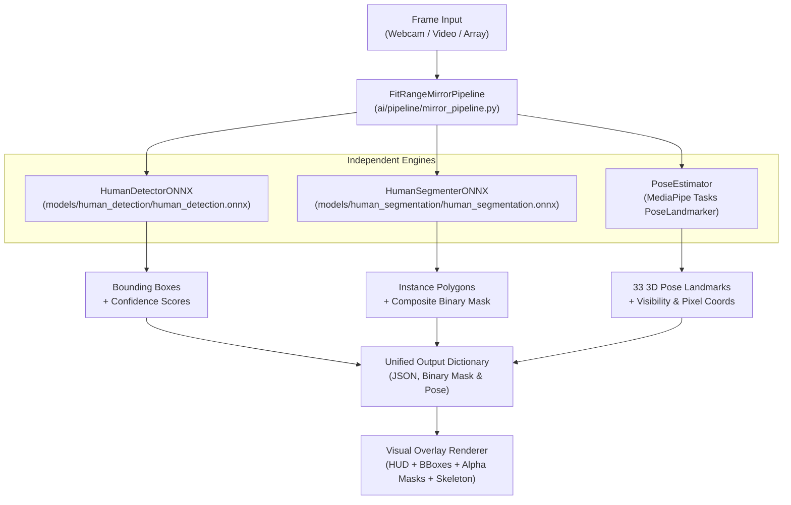

# FitRange Mirror - Integrated AI Pipeline

This directory provides the **Integrated Human Detection, Human Segmentation, and Pose Estimation Pipeline** for the FitRange Mirror system.

It coordinates the independent ONNX Human Detection, ONNX Human Instance Segmentation, and Google MediaPipe Pose Landmarker engines to process webcam video streams, video files, or individual image frames in real time with high reliability and zero PyTorch runtime dependencies.

---

## 1. Architecture



---

## 2. Key Features

- **Three Independent Engines:** Coordinates `HumanDetectorONNX`, `HumanSegmenterONNX`, and `PoseEstimator` independently without combining them into a monolithic network.
- **Official Google MediaPipe Pose Landmarker:** Integrates official MediaPipe Tasks PoseLandmarker (`.task`) predicting 33 body keypoints in real-world 3D meters and normalized image coordinates with visibility and presence confidence.
- **Webcam & Video Feed Support:** Direct ingestion of OpenCV BGR frames (`cv2.VideoCapture`).
- **Composite Binary Mask:** Provides a full-resolution single-channel `uint8` binary mask (values `0` or `255`) for the user silhouette, ready for downstream fitness tracking or virtual background replacement.
- **Empty Frame Handling:** When no person is detected, cleanly returns `has_person: False`, `person_count: 0`, empty detection/segmentation lists, `has_pose: False`, and an all-zero binary mask.
- **Flexible Execution Modes:** Supports running any subset of engines: detection only (`--no-seg --no-pose`), segmentation only (`--no-det --no-pose`), pose only (`--no-det --no-seg`), or all three concurrently.
- **Edge Deployment Ready:** Uses `onnxruntime` and MediaPipe with minimal memory footprint and zero PyTorch training framework overhead in memory.

---

## 3. Output Schema

The `process_frame()` method returns a structured dictionary:

```python
{
    "has_person": True,
    "person_count": 1,
    "detections": [
        {
            "bbox": [21.69, 35.93, 174.31, 388.19],
            "confidence": 0.9054,
            "class_id": 0,
            "class_name": "person"
        }
    ],
    "segmentations": [
        {
            "bbox": [20.41, 35.91, 174.64, 380.73],
            "confidence": 0.9032,
            "class_id": 0,
            "class_name": "person",
            "polygon": [[105.0, 36.0], [104.0, 37.0], ...],
            "mask_area": 25997
        }
    ],
    "composite_mask": np.ndarray,  # uint8 array of shape (H, W), values {0, 255}
    "pose": {
        "has_pose": True,
        "landmarks": [
            {
                "id": 0,
                "name": "nose",
                "x": 0.523,
                "y": 0.187,
                "z": -0.215,
                "visibility": 0.998,
                "pixel_x": 284,
                "pixel_y": 102
            },
            # ... 33 landmarks total
        ],
        "world_landmarks": [
            # ... 33 landmarks in real-world 3D metric coordinates (meters)
        ]
    },
    "frame_shape": (548, 543)
}
```

When no person is detected:
- `has_person`: `False`
- `person_count`: `0`
- `detections`: `[]`
- `segmentations`: `[]`
- `composite_mask`: All-zero NumPy array of shape `(H, W)`
- `pose`: `{"has_pose": False, "landmarks": [], "world_landmarks": []}`

---

## 4. Usage Guide

### 4.1 Python API

```python
import cv2
from ai.pipeline import FitRangeMirrorPipeline

# Initialize the integrated pipeline with all three components
pipeline = FitRangeMirrorPipeline(
    det_conf=0.35,
    seg_conf=0.35,
    pose_conf=0.50,
    enable_detection=True,
    enable_segmentation=True,
    enable_pose=True
)

# Read frame from webcam or file
frame = cv2.imread("dataset/human detection dataset/1/0.png")

# Process frame
result = pipeline.process_frame(frame)
print(f"People detected: {result['person_count']}")
print(f"Has pose: {result['pose']['has_pose']}")

if result["pose"]["has_pose"]:
    nose = result["pose"]["landmarks"][0]
    print(f"Nose at ({nose['pixel_x']}, {nose['pixel_y']}), visibility: {nose['visibility']:.2f}")

# Extract binary segmentation mask
mask = result["composite_mask"]  # (H, W) uint8 with 0 for background, 255 for person

# Render visual overlay (HUD, boxes, semi-transparent mask, skeleton connections)
annotated_frame = pipeline.render_visualization(frame, result, fps=30.0)
cv2.imwrite("output.jpg", annotated_frame)
```

---

### 4.2 CLI Application ([run_mirror.py](file:///c:/Users/dayan/Downloads/realtime-human-detection-main/realtime-human-detection-main/ai/pipeline/run_mirror.py))

#### Live Webcam Execution:
```bash
# Start default webcam (index 0) with detection, segmentation, and pose
python -m ai.pipeline.run_mirror

# Specify webcam index (e.g. external USB camera index 1)
python -m ai.pipeline.run_mirror --source 1
```

#### Video File or Static Image:
```bash
# Run on video file and save output
python -m ai.pipeline.run_mirror --source "path/to/workout.mp4" --save "annotated_workout.mp4"

# Process static test image
python -m ai.pipeline.run_mirror --source "dataset/human detection dataset/1/0.png" --save "annotated.jpg"
```

#### Selective Component Modes:
```bash
# Disable pose estimation (detection + segmentation only)
python -m ai.pipeline.run_mirror --no-pose

# Detection only (skip segmentation and pose)
python -m ai.pipeline.run_mirror --no-seg --no-pose

# Segmentation only (skip detection and pose)
python -m ai.pipeline.run_mirror --no-det --no-pose

# Headless benchmark mode (no GUI window opened)
python -m ai.pipeline.run_mirror --source "dataset/human detection dataset/1/0.png" --no-display
```

---

## 5. Running Automated Integration Tests

Execute the pipeline integration test suite:

```bash
python tests/test_mirror_pipeline.py -v
```

Execute the pose estimator test suite:

```bash
python tests/test_pose_estimator.py -v
```

Execute all project tests (14 detection + 15 segmentation + 11 pose + 11 pipeline = 51 total):

```bash
python tests/test_human_detection.py -v
python tests/test_human_segmentation.py -v
python tests/test_pose_estimator.py -v
python tests/test_mirror_pipeline.py -v
```
